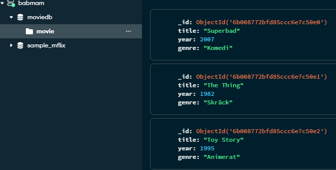
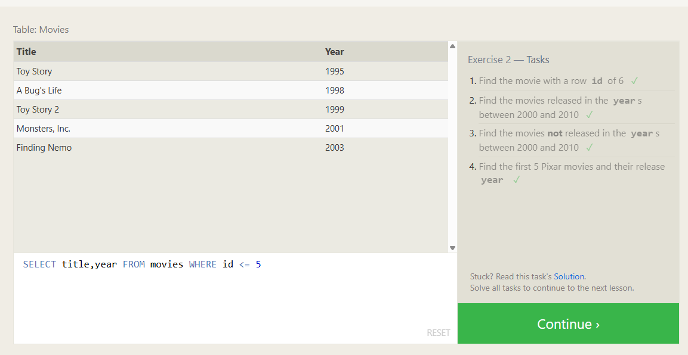

# Labb 1

# MySQL

Skärmdump som visar database explorer i IntelliJ med skapad person-tabell med data:

NOT: Ni ska även ha skapat en user som bara har access till databasen my_database, ingen bild krävs

# MongoDB

Skärmdump av databas på MongoDB Atlas med skapad movie-collection med data:

# SQL

Skärmdump som visar att ni klarat av första två sidorna på sqlbolt.com:s interaktiva tutorial

# Frågor som ni ska svara på (G-nivå)

Besvara frågorna med egna ord. Ge gärna exempel.

## Databaser och verktyg

1. Vad är en databas, och vad kan den användas till?
En databas är en organiserad samling av data. Den gör det möjligt att snabb söka efter,
lägga till eller ändra på information istället för att leta efter info på en .txt fil. Ett bra
exempel är spel som sparar data om hur långt man har kommit i ett spel och inloggningsuppigifter.
2. Vad används språket SQL till?
SQL är ett språk som används för att prata med en Databas, med den kan man skapa, lägga till, hämta
eller byta och ta bort data, till exempel om en spelare har inte spelat på 5 år det är onödig data
som man kan skriva med SQL till databasen att radera den spelares data.

## Tabeller och relationer

3. Vad är en tabell, en rad och en kolumn?
En tabell är där all data sitter som en xcel spreadsheet, en rad är data som sparas horisontell så typ
id, title,director och year i princip en complet record av en spcifik film, en kolumn är vertikal
data sparning så det sparar bara en typ av information som till exempel year, den kolumn har åren
för all filmer.
4. Vad är en primärnyckel, och varför behövs den?
Det är en unik värde, som en id och den behövs för att stoppa duplications, så om några personer har
samma namn istället för att skriva över den personen så får den en ny id istället.
5. Vad är en främmande nyckel?
Det är en kolumn i en tabell som pekar på primärnyckel i en annan tabell, det används för att 
koppla ihop tabeller. Exempel på det är att du har en kolumn som heter kund_id. Så om ett köp
har kund_id 2, betyder det att köpet gjordes av kunden med id 2 i kundtabellen.
6. Varför är det bra att lagra kunduppgifter och köp i olika tabeller?
Det är bra för att undvika att samma information upprepas på flera ställen,om allt ligger i 
samma tabell och en kund flyttar då måste man ändra adressen på flera ställen och om man glömmer en
så blir datan fel. Om kunduppigifter ligger istället i en egen tabell så finns det bara på ett ställe
och köpen pekar på kunden med en främmande nyckeln.

## NoSQL

7. Vad menas med NoSQL, och hur kan information organiseras i en sådan databas?
NoSQL betyder att det är databaser som inte använder sig av tabeller med rader och kolumner som SQL.
Infromationen kan organiseras istället som dokument som i mongoDB, där varje film som man la till
var ett dokument som ser ut som JSON. En annat sätt är nyckel-värde-par som i Redis där man sparar
värde under en nyckel.
8. Ge ett exempel på när en NoSQL-databas kan vara lämplig och förklara varför.
Ett bra exempel skulle kunna vara en leaderboard i ett spel där man vill visa de bästa spelarna.
Redis passar perfekt här eftersom all data sparas i RAM, vilket gör den mycket snabbare än en
databas som läser från en hårddisk. Det är viktigt eftersom poängen ändras hela tiden och många
spelare kollar på leaderboard samtidigt.

## SQL – hämta data från tabellen person

Skriv en SQL-fråga som svar på varje uppgift.

9. Hämta alla kolumner för alla personer i tabellen.
SELECT * FROM person;

10. Hämta endast förnamn och efternamn för alla personer.
SELECT first_name,last_name FROM person;

11. Hämta förnamn, efternamn och inkomst för personer med en inkomst över 30 000.
SELECT first_name,last_name, income FROM person WHERE income > 30000;

12. Hämta alla personer födda före den 1 januari 1990.
SELECT * FROM person WHERE birth_date < '1990-01-01';

13. Hämta förnamn, efternamn och inkomst, sorterat efter inkomst från högst till lägst.
SELECT first_name,last_name, income FROM person ORDER BY income DESC;

14. Räkna hur många personer som finns i tabellen.
SELECT COUNT(*) FROM person;

# VG-nivå

Dessa frågor ska besvaras med ett längre svar, minst en halv A4-sida:

1. En banköverföring avbryts efter att pengarna dragits från det första kontot.
   Vad kan konsekvensen bli, och hur kan en transaktion hjälpa?

2. Välj ett enkelt system, antingen en webbutik eller en chatt.
   Resonera om när en relationsdatabas respektive en NoSQL-databas
   kan vara lämplig. Motivera med hur informationen ska lagras och användas.

